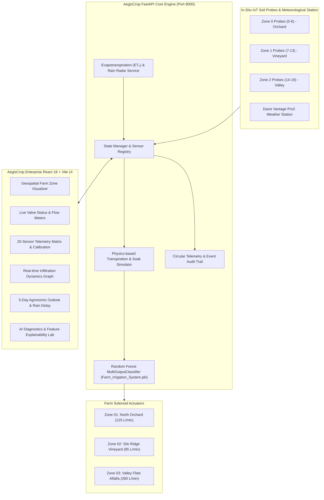

# AegisCrop OS™ — Enterprise Smart Irrigation & Agronomic IoT Platform

> **A human-crafted, corporate-grade Precision Agriculture & Autonomous Irrigation System** powered by a Scikit-Learn Multi-Output Random Forest classifier, high-density React + Tailwind CSS dashboard, and physics-based real-time soil telemetry simulator.

---

## 🌟 Executive Summary

The **AegisCrop OS™** transforms the original prototype machine learning model into a full-scale corporate agronomic command platform. Designed for commercial farm managers, greenhouse agronomists, and IoT engineers, it bridges real-time telemetry, predictive multi-zone solenoid valve actuation, and meteorological intelligence into a single unified platform.

---

## 🏗️ System Architecture



---

## ✨ Key Enterprise Capabilities

### 1. Multi-Output Random Forest ML Engine
* Employs the trained `Farm_Irrigation_System.pkl` model (`MultiOutputClassifier(RandomForestClassifier)`).
* Ingests a 20-dimensional scaled soil moisture vector (`0.0` to `1.0`) and predicts binary valve actuation across 3 distinct farm parcels simultaneously.
* **Model Explainability**: Calculates Gini feature importances to show agronomists *why* a valve was opened (e.g. *"Probe #6 and Probe #17 rootzone deficit triggered Parcel 0 activation with 94.2% confidence"*).

### 2. Dual Operating Modes & Safety Interlocks
* **Autonomous AI Mode**: Continuously evaluates in-situ probe readings and actuates solenoids dynamically based on multi-label classifier predictions.
* **Manual Engineering Override**: Direct manual toggle switches with safety interlocks and timed flushes.
* **Weather-Adaptive Eco Mode**: Adjusts irrigation cycles according to evapotranspiration ($ET_0$) rates and relative humidity.
* **Emergency Cut-Off**: Immediate physical shutoff to de-energize all 24V solenoids across the entire facility.

### 3. Realistic Soil Moisture Physics Simulator
* **Soak Phase**: When a sprinkler is active, assigned probes absorb moisture gradually (+0.015 to +0.035 per tick) based on probe depth ($15\text{cm}$, $30\text{cm}$, $45\text{cm}$, $60\text{cm}$) and soil texture.
* **Depletion Phase**: When valves are closed, moisture naturally evaporates and drains (-0.003 to -0.007 per tick).
* **Live Closed-Loop**: Watch the AI autonomously turn on sprinklers when moisture drops, and automatically shut them off once field capacity is reached!

### 4. Interactive Agronomic Scenario Lab
Test real-time model behavior with single-click stress tests:
* **Severe Drought Heatwave**: Rapidly depresses soil moisture across all zones to evaluate emergency multi-parcel response.
* **35mm Storm Influx**: Simulates heavy rain runoff to verify automatic valve suspension.
* **Targeted Orchard Deficit**: Dry out only Zone 0 while leaving Zones 1 & 2 optimal.
* **Equilibrium Baseline**: Restores all probes to optimal agronomic balance.

---

## 🚀 Quick Start Guide

### Option 1: One-Click Production Launch (Single Command)
Double-click `start_system.bat` or run:
```powershell
.\start_system.ps1
```
This automatically starts the backend server on `http://127.0.0.1:8000` and serves the production-compiled frontend dashboard.

### Option 2: Development Mode (Hot Reload)
Run the dev launcher:
```bat
start_dev.bat
```
* **Backend API**: `http://127.0.0.1:8000`
* **API Documentation**: `http://127.0.0.1:8000/docs`
* **Vite Hot-Reload UI**: `http://localhost:5173`

---

## 📡 API Reference Summary

| Method | Endpoint | Description |
|---|---|---|
| `GET` | `/api/health` | Service health and ML model status |
| `GET` | `/api/system/status` | Complete live snapshot (valves, probes, flow rate, weather) |
| `POST` | `/api/system/mode` | Switch mode (`AI_AUTONOMOUS`, `MANUAL_OVERRIDE`, `WEATHER_ECO`) |
| `POST` | `/api/system/emergency-stop` | Engage/disengage facility-wide solenoid cut-off |
| `POST` | `/api/system/simulation-toggle`| Pause/resume physics-based soil telemetry loop |
| `POST` | `/api/system/scenario` | Inject agronomic stress scenario |
| `POST` | `/api/parcels/{id}/valve` | Actuate individual solenoid (`0` = OFF, `1` = ON) |
| `POST` | `/api/sensors/{id}` | Calibrate sensor moisture fraction (`0.0` - `1.0`) |
| `POST` | `/api/predict` | Run direct inference on any 20-element vector |
| `GET` | `/api/weather` | Current weather station telemetry & 5-day ET forecast |
| `GET` | `/api/analytics/history` | Rolling telemetry time-series for charts |
| `GET` | `/api/logs` | Chronological audit trail of valve transitions |

---

## 🛠️ Tech Stack

* **Backend**: Python 3.14+, FastAPI, Uvicorn, Scikit-Learn, Pandas, NumPy, Joblib, Pydantic v2.
* **Frontend**: React 18, Vite, TypeScript, Tailwind CSS, Lucide React Icons.
* **Agronomy & ML**: MultiOutputClassifier (Random Forest Ensemble), Crop Evapotranspiration ($ET_0$), Volumetric Water Content (VWC) calibration.
